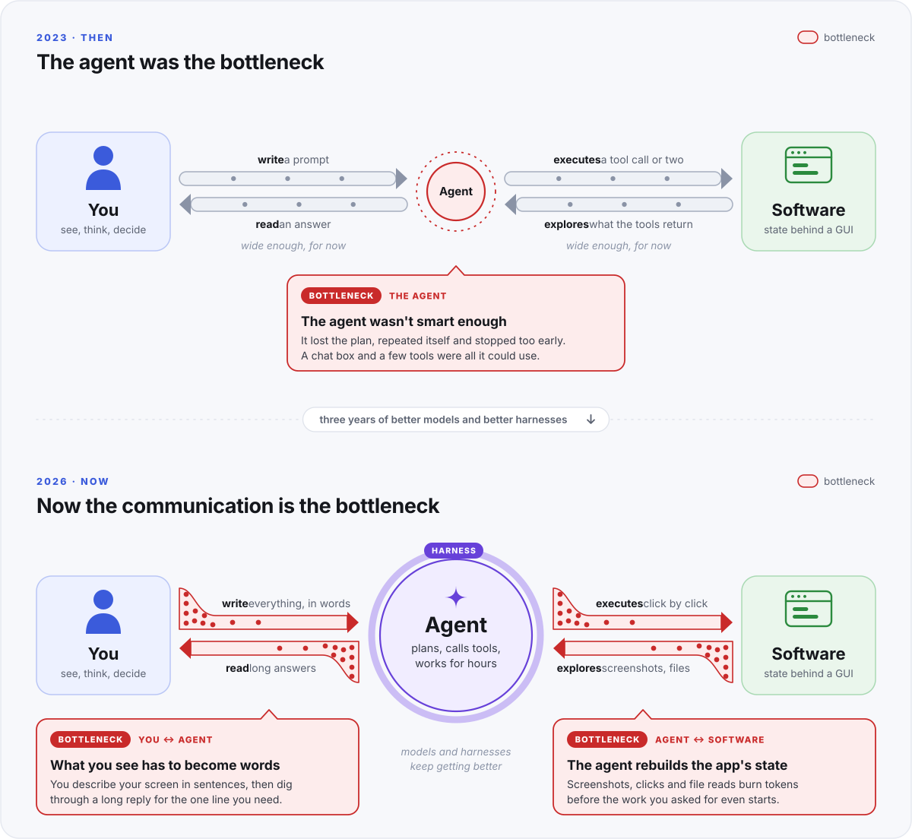
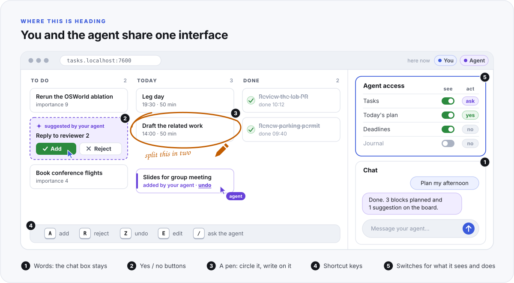

# LaunchX

**The launcher and the contract for a software ecosystem that people and their agents share.**

LaunchX is two things. It is a launcher that runs your local apps from one place, with a Mac app you drive with the mouse. And it is a [contract](SPEC.md) for how an app opens itself to both of its users: the person and the person's agent. This README starts with the thinking behind the contract. The practical part starts at [Install](#install).

<p align="center">
  <a href="#why-a-new-ecosystem">Why</a> ·
  <a href="#the-philosophy">The philosophy</a> ·
  <a href="#what-the-contract-asks">What the contract asks</a> ·
  <a href="#install">Install</a> ·
  <a href="#commands">Commands</a> ·
  <a href="SPEC.md">The contract</a>
</p>

## Why a new ecosystem

First there were LLMs, and all an LLM could do was chat. We wanted them to act, so we gave them tools and a loop to use them in, and the code around the model became the harness. From 2023 to 2026 most of the invention went into that harness, and it worked: an agent can now plan, call tools and work for hours.

The interface did not move. A person still tells an agent everything in words, in a chat session, and reads long text back. An agent still reaches software through the door that was built for people: a screenshot, a click, another screenshot, or one file after another, spending tokens to learn a state the app already knows.

<p align="center"></p>

So the limit is no longer the model, and it is no longer the harness. It is the place where the person, the agent and the software meet. Two questions follow from that:

- Who said people must convey information in words?
- Who said an agent must walk an app from its front to its back to read and change its state?

Answering them is interface engineering, and it is all this project does. LaunchX does not make a better model or a better harness. It describes software that a person and an agent can use together, and it runs that software.

## The philosophy

Eight ideas shape the contract. Each is a claim about how software should be built now that it has two kinds of user.

**1. An app can say what state it is in.** Everything its page shows comes from one JSON document, and the page has no private channel, so nothing exists only on screen. An agent learns in one call what would otherwise take a chain of screenshots. The contract's test: someone holding only the documentation and a token could rebuild the whole page.

**2. Every action is a command.** Anything a person can do on the page, a command can do, and the result shows on the page at once. The command line is a peer of the page, never an afterthought. An agent acts in one step, and so can a script or another app.

**3. The person holds the switches.** An agent works on an app with its owner's authorization, never around it. In LaunchX every app is hidden from agents until you switch it on, and an app can let an agent propose a change that waits for your yes.

<p align="center"></p>

**4. The page is shared.** An app's interface is a web page served by its own backend. It is the same page for you and for your agent's work: what the agent does appears where you are already looking, so it does not have to describe your own app to you in a chat.

**5. Words are one input among several.** On a shared page you can answer an agent with a button, a switch or a drag, and next with a pen or a shortcut key. The chat box stays for what is best said as a sentence. An app should offer the quickest way to say each thing.

<p align="center"></p>

**6. Apps stay small; the launcher owns the plumbing.** An app is handed its port and its token and runs in the foreground. Sign-in, logs, restarts, health and the order apps start in belong to the launcher, once, for every app.

**7. Local first.** Data lives in files you own, an app listens only on your own machine unless you decide otherwise, and anything private (the names of your machines, your organisation, your accounts) stays in a file outside the app's repository.

**8. No side taken on models or harnesses.** The contract asks nothing of an agent except that it can run a command and read JSON, so whichever model and harness you use next year will work. It asks little of software too: an app that has never heard of LaunchX joins with a manifest and no code changes.

The two pictures show where this is heading. Draft 0.1 of the contract already requires ideas 1, 2, 4 and 6, and is built around 7 and 8. For idea 3 it has one switch per app, and that switch decides what agents are told, not what they can reach; a switch for each part of an app is not there yet. Idea 5 is up to each app today: buttons, switches and drags work, and the pen and the shortcut keys are still plans.

## What the contract asks

An app describes itself in a `launchx.toml` manifest and claims one of three levels. [SPEC.md](SPEC.md) has the full text and two worked examples.

| Level | The app must | What it gets |
|---|---|---|
| 0, described | Have a manifest. No code changes. | Start, stop, restart, logs and dependency ordering. |
| 1, managed | Run in the foreground on the port and token it is handed, and report its health. | A port and a token from the launcher, health on its card, and its page at a stable signed-in address such as `http://vmc.localhost:7600/`. |
| 2, open | Expose its whole state as JSON and ship a CLI that can do what its page can. | Agents, scripts and other apps can read it and drive it. |

The launcher does the rest. It starts each app in the order its dependencies need, watches its health, keeps its logs, puts every page behind one sign-in, and has the switch that decides whether your agents are told about an app. `lx check <id>` tests an app against the level it claims.

LaunchX is part of [AutoPhD](https://github.com/AutoPhd-org), which builds apps on this contract. Status: contract draft 0.1, working launcher on macOS and Linux; the app is macOS only.

## Install

Needs Rust (cargo) and, on macOS, the Xcode command-line tools (swiftc).

```sh
./install.sh            # macOS: LaunchX.app into ~/Applications, lx linked into ~/.local/bin
lx up                   # start the launcher now and at every login
lx add ~/code/my-app    # register a service by its directory
```

On Linux `install.sh` copies `lx` into `~/.local/bin`; use the browser page at `http://launchx.localhost:7600/` (`lx open`).
`lx daemon` runs the launcher in a terminal instead of at login.

## The app (macOS)

Open **LaunchX** from Launchpad, Spotlight or `~/Applications`.

- **Main window:** every service as a card with its status, health, summary, version and port, plus Open, Start, Stop, Restart and Logs buttons. It is the launcher's web page, signed in automatically.
- **Open** sends a service's page to your default browser, already signed in (starting the service first if needed). After that, a bookmark such as `http://vmc.localhost:7600/` signs in on its own for 30 days.
- **Menu bar (paper plane):** each service with a coloured dot and Open / Start / Stop / Restart, without opening the window.
- **When the launcher is not running,** the window offers a Start button (it runs `lx up`).

LaunchX is the only app: services stay in the browser, where they get tabs, bookmarks, Find and extensions. Quitting the app leaves the launcher and services running; they belong to the daemon, not the window. The app carries its own copy of `lx`, which `~/.local/bin/lx` links to.

## Commands

| Command | Does |
|---|---|
| `lx ls` | Services with status, health, version, port and summary. |
| `lx start <id>` / `lx stop <id>` / `lx restart <id>` | Control a service. Start brings up what it requires; stop first stops what requires it. Services you started come back when the launcher restarts (at login, after an update) until you stop them. |
| `lx open [id]` | Open the launcher, or a service's page, in the browser. |
| `lx logs <id> [-f] [-n N]` | Captured output, including the launcher's own notes (`[launchx]`). |
| `lx add <path>` / `lx rm <id>` | Register or unregister a manifest. `rm` removes the link in `~/.launchx/services`, never the manifest. |
| `lx check <id>` | Start a temporary copy on a spare port and test it against the level it claims. |
| `lx state` | The launcher's full state document as JSON. |
| `lx up` / `lx down` | Register or remove the launcher as a login service, and start or stop it. |
| `lx agents` / `lx agents on <id>` / `lx agents off <id>` | What your AI agents can discover, and the switch for each service (see below). |

Every page of the launcher is also an API: `GET /api/state`, `GET /api/events` (server-sent events), `POST /api/services/<id>/start`. Programs reach it at `http://127.0.0.1:7600` with the token in `~/.launchx/run/launchx.json`.

## Agents

Each service has a **Discoverable by agents** switch: on its card, in the menu bar, or `lx agents on|off <id>`. It starts off. While a service is on:

- `lx agents` (and `--json`) lists it with its CLI, state, run file and skills;
- its skills (`[service.<id>.agents] skills = "…"` in its manifest) are linked into `~/.claude/skills` and `~/.agents/skills`, whichever exist (`agent_skill_dirs` in `config.toml`);
- a generated `launchx` skill tells your agent which apps it may use and how, and to leave the others alone.

Switching a service off removes what LaunchX put there; LaunchX never touches skills it did not create. The switch controls what agents are told, not what they can reach: an agent runs as you, so it could still find a hidden service if it went looking.

## Files

`~/.launchx` (or `$LAUNCHX_HOME`), mode 0700:

```
config.toml        gateway_port = 7600, backoff_unit_ms = 1000
services/          links to registered manifests
run/<id>.json      URL, token and pid of each running service (mode 0600)
logs/<id>.log      captured output, rotated at 5 MB
agents/skills/     skills published to your agents, linked from their skill folders
state.json         assigned ports and tokens, the session secret, and the agents switches (mode 0600)
```

## Development

```sh
cargo test          # unit tests and an end-to-end run against fixture services
```

The end-to-end test starts a real daemon on a spare port with fixture services and covers dependency order, sign-in, the token swap, the Origin check, streaming and Upgrade through the gateway, restart back-off, `lx check`, the agents switch, and shutdown.

## License

MIT. See [LICENSE](LICENSE).
