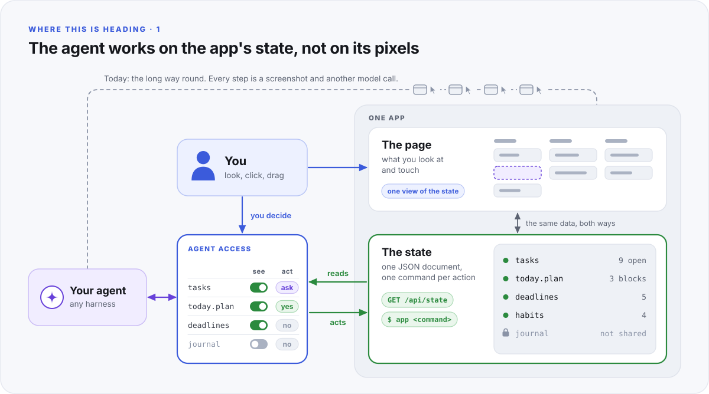
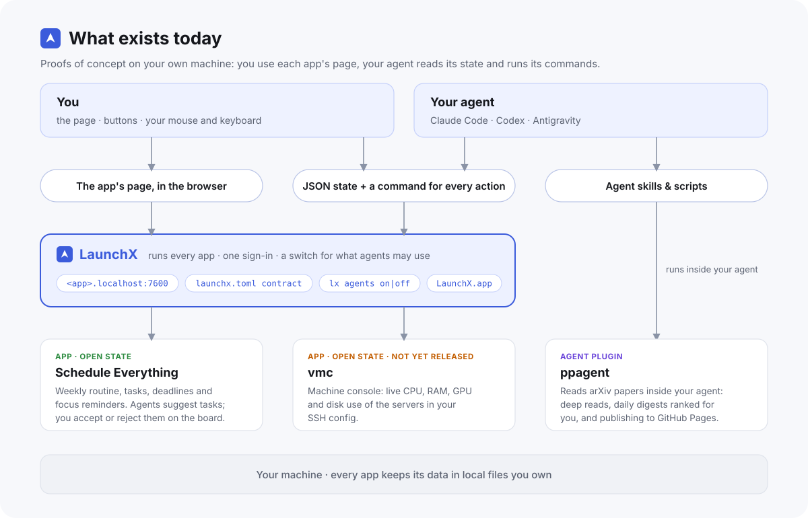

# LaunchX

**The launcher and the contract for apps that people and their agents use together.**

LLMs started out as chatbots. We wanted them to act, so we wrapped them in harnesses, and from 2023 to 2026 the harness is where most of the invention went. The interface stayed where it was. You still tell an agent everything in words, in a chat session, and the agent still reaches your software through its front door: screenshots, clicks and file reads that burn tokens before the work you asked for even starts.

[AutoPhD](https://github.com/AutoPhd-org) works on that part. We don't make better models or better harnesses; we try to build software in which an agent sees an app's state directly and you can answer it with more than words. LaunchX is the foundation, and it does two jobs:

- **A contract** ([SPEC.md](SPEC.md)) for how an app opens itself up: its whole state as one JSON document, a command for every action, and its page in the browser. An agent reads the state in one call, acts with one command, and what it did shows up on the page you are looking at.
- **A launcher** that runs such apps on your machine. Each app describes itself in a `launchx.toml` manifest; LaunchX starts it in the order its dependencies need, gives it a port and a token, watches its health, keeps its logs, and puts its page behind one signed-in address such as `http://vmc.localhost:7600/`. A switch per app decides whether your agents are told about it. On macOS it comes with an app you drive with the mouse.

<p align="center"></p>

The picture is where this is heading. Today LaunchX gives you the state document, the commands and one switch per app; switches for each part of an app come next.

## The contract in short

An app that follows the contract:

- **exposes its whole state** as one JSON document, so nothing is only visible on screen and an agent never has to rebuild it from pixels;
- **has a CLI that is a peer of its GUI**, so an agent can do anything you can, and the page shows it at once;
- **puts its GUI in the browser**, where you already have tabs, bookmarks and your password manager, and where you and your agent can share one page;
- **runs in the foreground under the launcher**, which hands it a port and a token and keeps everything else (sign-in, logs, restarts, dependencies) out of the app.

<p align="center"></p>

Status: contract draft 0.1, working launcher on macOS and Linux; the app is macOS only.

## Install

Needs Rust (cargo) and, on macOS, the Xcode command-line tools (swiftc).

```sh
./install.sh            # macOS: LaunchX.app into ~/Applications, lx linked into ~/.local/bin
lx up                   # start the launcher now and at every login
lx add ~/code/my-app    # register a service by its directory
```

On Linux `install.sh` copies `lx` into `~/.local/bin`; use the browser page at `http://launchx.localhost:7600/` (`lx open`).
`lx daemon` runs the launcher in a terminal instead of at login.

## The app (macOS)

Open **LaunchX** from Launchpad, Spotlight or `~/Applications`.

- **Main window:** every service as a card with its status, health, summary, version and port, plus Open, Start, Stop, Restart and Logs buttons. It is the launcher's web page, signed in automatically.
- **Open** sends a service's page to your default browser, already signed in (starting the service first if needed). After that, a bookmark such as `http://vmc.localhost:7600/` signs in on its own for 30 days.
- **Menu bar (paper plane):** each service with a coloured dot and Open / Start / Stop / Restart, without opening the window.
- **When the launcher is not running,** the window offers a Start button (it runs `lx up`).

LaunchX is the only app: services stay in the browser, where they get tabs, bookmarks, Find and extensions. Quitting the app leaves the launcher and services running; they belong to the daemon, not the window. The app carries its own copy of `lx`, which `~/.local/bin/lx` links to.

## Commands

| Command | Does |
|---|---|
| `lx ls` | Services with status, health, version, port and summary. |
| `lx start <id>` / `lx stop <id>` / `lx restart <id>` | Control a service. Start brings up what it requires; stop first stops what requires it. Services you started come back when the launcher restarts (at login, after an update) until you stop them. |
| `lx open [id]` | Open the launcher, or a service's page, in the browser. |
| `lx logs <id> [-f] [-n N]` | Captured output, including the launcher's own notes (`[launchx]`). |
| `lx add <path>` / `lx rm <id>` | Register or unregister a manifest. `rm` removes the link in `~/.launchx/services`, never the manifest. |
| `lx check <id>` | Start a temporary copy on a spare port and test it against the level it claims. |
| `lx state` | The launcher's full state document as JSON. |
| `lx up` / `lx down` | Register or remove the launcher as a login service, and start or stop it. |
| `lx agents` / `lx agents on <id>` / `lx agents off <id>` | What your AI agents can discover, and the switch for each service (see below). |

Every page of the launcher is also an API: `GET /api/state`, `GET /api/events` (server-sent events), `POST /api/services/<id>/start`. Programs reach it at `http://127.0.0.1:7600` with the token in `~/.launchx/run/launchx.json`.

## Agents

Each service has a **Discoverable by agents** switch: on its card, in the menu bar, or `lx agents on|off <id>`. It starts off. While a service is on:

- `lx agents` (and `--json`) lists it with its CLI, state, run file and skills;
- its skills (`[service.<id>.agents] skills = "…"` in its manifest) are linked into `~/.claude/skills` and `~/.agents/skills`, whichever exist (`agent_skill_dirs` in `config.toml`);
- a generated `launchx` skill tells your agent which apps it may use and how, and to leave the others alone.

Switching a service off removes what LaunchX put there; LaunchX never touches skills it did not create. The switch controls what agents are told, not what they can reach: an agent runs as you, so it could still find a hidden service if it went looking.

## Files

`~/.launchx` (or `$LAUNCHX_HOME`), mode 0700:

```
config.toml        gateway_port = 7600, backoff_unit_ms = 1000
services/          links to registered manifests
run/<id>.json      URL, token and pid of each running service (mode 0600)
logs/<id>.log      captured output, rotated at 5 MB
agents/skills/     skills published to your agents, linked from their skill folders
state.json         assigned ports and tokens, the session secret, and the agents switches (mode 0600)
```

## Development

```sh
cargo test          # unit tests and an end-to-end run against fixture services
```

The end-to-end test starts a real daemon on a spare port with fixture services and covers dependency order, sign-in, the token swap, the Origin check, streaming and Upgrade through the gateway, restart back-off, `lx check`, the agents switch, and shutdown.

## License

MIT. See [LICENSE](LICENSE).
